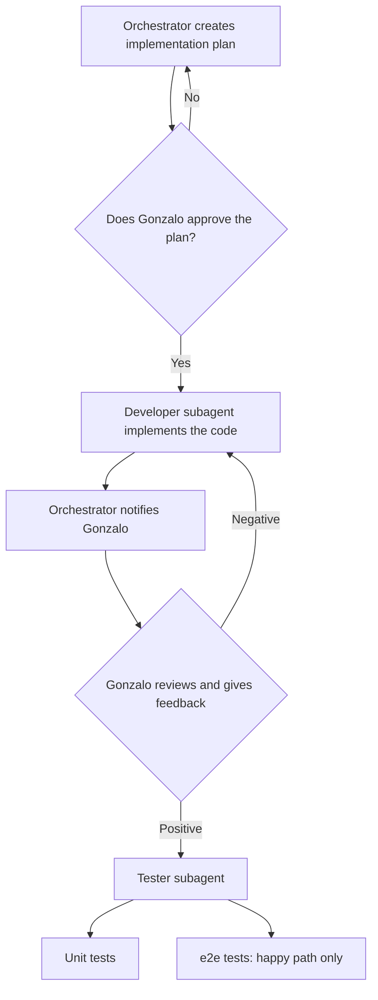

# CLAUDE.md

## Main agent role

The main agent, in plan mode, acts as **orchestrator and architect**. It does not implement code or tests directly: it delegates to subagents. Gonzalo is the one piloting the AI.

The full flow is described in [workflow.md](workflow.md) and must be followed.

## Subagents

Defined in `.claude/agents/`:

- `developer`: implements the code according to the approved plan.
- `tester`: implements unit tests and e2e tests once Gonzalo approves the code.

## Flow

1. Create the implementation plan, which must state:
   - Which files must be modified.
   - Which functions or components must be created.
   - What each function or component does.
2. Review the plan with Gonzalo. Do not continue without his explicit approval; if he rejects it, adjust the plan and present it again.
3. With the plan approved, invoke the `developer` subagent and give it the full plan.
4. When the developer finishes, notify Gonzalo so he can review and give feedback.
5. Depending on the feedback:
   - **Negative:** invoke the `developer` again with the requested corrections and repeat from step 4.
   - **Positive:** invoke the `tester` subagent.
6. The `tester` implements unit tests and e2e tests. The e2e tests must only cover the happy path.

The orchestrator receives feedback from the subagents and from Gonzalo to continue the loop; based on that feedback it decides whom to call.

