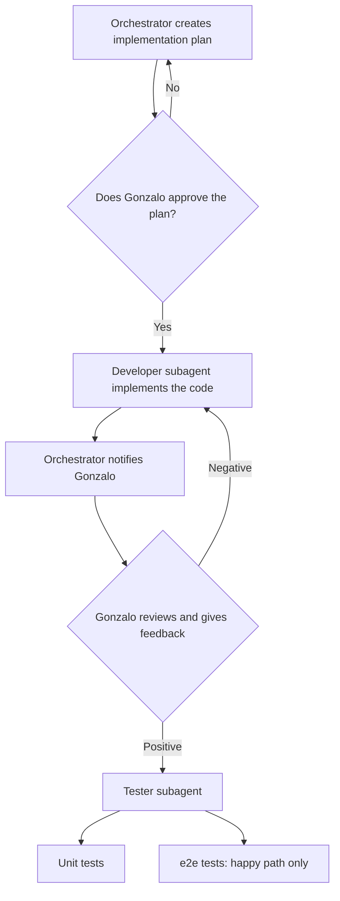

# Workflow

The main agent, in plan mode, acts as orchestrator and architect.
The orchestrator must call the relevant subagents to complete its task.
The orchestrator receives feedback from the subagents and from Gonzalo to continue the loop. Gonzalo is the one piloting the AI.
Depending on the feedback, it decides whom to call.

The orchestrator creates an implementation plan:
- Which files must be modified.
- Which functions or components must be created.
- What each function or component does.

The orchestrator reviews the plan with Gonzalo.
If approved, the orchestrator hands the plan to the developer subagent.
The developer subagent implements the code.
The orchestrator notifies Gonzalo.
Gonzalo reviews and gives feedback.
If negative, the developer subagent is invoked to make the changes.
If positive, the Tester subagent is invoked to implement:
- Unit tests
- e2e tests
The e2e tests must only cover the happy path.

## Diagram

